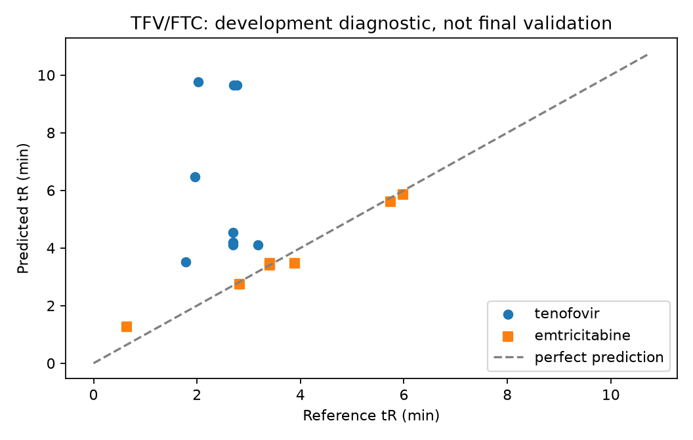

# TFV + FTC: сравнение колонок и открытых методов

Дата: 23 октября 2026. Исследовательский отчёт.

## Рекомендуемый первый эксперимент

Thermo Scientific Acclaim RSLC 120 C18, 100 × 2.1 мм, 2.2 мкм; исходная программа report:0386, pH A по источнику 2.6, 30 °C. Выбран по полноте источника и известным паспортным ограничениям, не как доказанный ML-оптимум. Полные составы фаз, градиент, предложенные параметры ввода/детекции, два запасных варианта и обязательные проверки приведены в «Задание_в_лабораторию.docx» и LAB_PLAN.md. Передать аналитику для подготовки скрининга; запуск требует его проверки и согласования. Разделение не подтверждено.

## Резюме

Построен и проверен исследовательский прототип на открытых данных. Выполнено компьютерное сравнение 84 программ на 10 продуктах колонок. Это не лабораторные испытания. Система прогнозирует времена удерживания, сохраняет происхождение условий и исключает неполные/противоречивые методы. Доказанного оптимума и подтверждённого разделения TFV/FTC пока нет: модель ширин пиков и Rs отсутствует.

## Постановка задачи

Вход: химические структуры TFV и FTC, колонка и программа ВЭЖХ. Выход текущей модели: tR каждого вещества в минутах и диапазон неопределённости. Целевая промышленная задача шире: подобрать воспроизводимое разделение смеси при допустимых давлении, времени и расходе растворителя. TFV нельзя подменять пролекарствами TDF/TAF. Пользователь подтвердил целевую пару TFV + эмтрицитабин; именно она рассматривается в отчёте.

## Использованные данные

RepoRT: 183 818 наблюдений в 421 системе; RP-поднабор — 173 949 наблюдений. METLIN SMRT и U Liège собраны отдельно; их нельзя просто суммировать с RepoRT из-за пересечений. Для целевых веществ найдены 21 наблюдение и 7 общих систем. Общий метод не подтверждает совместную инъекцию. Собраны 306 реальных QC-сигналов с предварительными ширинами/Rs, но это другая смесь, не доказательство разделения TFV/FTC. Извлечены 67 таблиц из 15 разрешённых к повторному использованию статей. Данные заказчика не использованы.

## Контроль качества источников

Таблицы вне основного текста JATS теперь извлекаются. В PMC12114340 времена TFV/FTC в тексте (5,08/6,21 мин) противоречат таблице 5 (0,80/0,78 мин), включая порядок выхода. Обе версии изолированы. 13 опытов PMC3929521 относятся к FTC/ламивудину, а не TFV/FTC; условия pH и объёма ввода противоречивы. Повтор METLIN в RepoRT 0209/0186 не считается независимым подтверждением. Программы с нарушением баланса фаз не исправлялись молча, а исключались из генерации кандидатов. Также обнаружено несовпадение названий CORTECS/Raptor Biphenyl между меткой метода и полем колонки: такие методы исключены из набора рекомендаций до сверки. Полный обучающий корпус ещё требует такого же первичного аудита; результаты его моделей не являются результатами обучения на полностью выверенной базе.

## Дополнительная проверка идентичности молекул

Из 21 кандидата RepoRT только 17 совпадают с целевыми веществами по полному InChIKey. Две записи FTC имеют другой стереохимический блок, две записи TFV не задают стереохимию. Они не считаются подтверждёнными измерениями нужных форм. Поэтому общая историческая диагностика на 21 строке показана отдельно от строгой проверки идентичности. Это различие важно: одинаковая связность не гарантирует ту же молекулу.

## Как устроено прогнозирование

RDKit: дескрипторы, функциональные группы и fingerprints; Dimorphite-DL: возможные зарядовые формы при pH метода (не измеренный pKa и не доли форм); CatBoost: регрессия log(1+tR). Учитываются геометрия, составы предварительно смешанных фаз, градиент, температура и гидродинамические признаки. RAG/поиск источников обеспечивает реальные методы и проверяемые ссылки. Языковая модель объясняет результаты, но не заменяет численный прогноз и эксперимент. log(k) не рассчитывается без достоверного t0.

## Обучение и проверка

Добавлены 18 000 обучающих наблюдений с последовательным обходом систем для улучшения их покрытия. Исходные выборки выбора модели (1 119), калибровки (1 800) и проверки (1 881 строка) заморожены. Молекулы контрольных выборок исключены из расширения обучения; TFV/FTC/TDF/TAF не используются при обучении. Выбор среди вариантов выполнен по macro-MAE на выборке выбора, а не по результату TFV/FTC. Контрольные примеры уже анализировались при разработке: это исследовательская проверка, не нетронутая финальная валидация.

## Почему больше данных не означает лучше для целевой смеси

В расширенном эксперименте общая MAE уменьшилась с 1,485 до 1,407 мин, но MAE TFV/FTC увеличилась с 1,485 до 2,294 мин. Ошибка на новых источниках также выросла с 2,81 до 3,29 мин. Это отрицательный результат для переноса на целевую задачу, который нельзя скрывать за улучшением общей метрики. Дополнительно проверено обучение с весами по структурной близости к TFV/FTC без использования их экспериментальных tR. Все варианты, включая неудачные, показаны в приложении.

## Измеренное качество выбранного варианта

MAE на фиксированной проверочной выборке: 1.364 мин; macro-MAE: 1.485 мин. Историческая диагностика по связности (21 строка): 2.479 мин. После полного InChIKey и исключения копии METLIN: 16 строк, MAE 2.185 мин. Правильный порядок выхода: 0 из 3 однозначных пар после исключения повтора METLIN. Это слишком мало для оценки вероятности успешного разделения. Радиус номинального 90%-интервала: 3.53 мин; фактическое покрытие молекулярных групп: 90.0%. Отдельный тест новых источников: MAE 3.24 мин, покрытие 88.5%. Эти интервалы не гарантируют такое же покрытие на произвольной новой колонке или сгенерированном градиенте.

## Как сравнивались колонки

Выбраны продукты с полными условиями и покрытием в обучении. Для каждого использовано до трёх открытых методов и масштабирование времени 0,8/1,0/1,2. Составы фаз не подменялись универсальным рецептом. Сравниваются пакеты «колонка + программа», а не изолированное влияние сорбента. Геометрия и фазы находятся в приложении и comparison.json; исходные градиенты — в CSV. Проверка допустимых режимов производителя завершена только для указанной геометрии Acclaim. Остальные кандидаты требуют проверки паспортов; ни один не разрешён к автоматическому запуску.

## Что можно рекомендовать сейчас

Использовать результаты как обоснованный список условий для последующего скрининга. Численное ранжирование по разнице прогнозных tR сохранено только как суррогат: оно не является ранжированием по Rs. При пересекающихся диапазонах прогнозов нельзя объявлять лучший метод или порядок выхода. HILIC, ионообменные и другие режимы этой RP-моделью не оценивались.

## План экспериментальной проверки

До запуска специалист подтверждает химическую форму, матрицу, точный артикул колонки, допустимые pH/растворители/давление и dwell volume прибора. Затем: холостой раствор, отдельные стандарты, смесь и повторные инъекции в выбранных совместимых условиях. Фиксируются tR, ширины пиков, измеренный Rs, форма пика, давление, температура и воспроизводимость. Условия/пороги пригодности согласуются с аналитиком под задачу; tR сам по себе не является критерием успешного разделения. После первых опытов можно применять байесовскую оптимизацию с ограничениями по измеренному качеству, времени и расходу. Она не заменяет измерения.

## Вывод для заказчика

Получена воспроизводимая система предварительного отбора ВЭЖХ-условий из открытых данных с прогнозом удерживания, контролем ошибок источников и явными границами применимости. Для утверждения о полноценной автоматической разработке метода необходимо подтвердить разделение смеси и перенос на конкретный прибор. Текущий результат — исследовательский shortlist, а не валидированная методика.

## Приложение 1. Сравнение моделей

| Эксперимент/признаки | Обучение, строк | Выбор: macro-MAE | Тест: MAE | TFV/FTC: MAE |
|---|---|---|---|---|
| realism_evaluation/baseline | 7200 | 1.804 | 1.600 | 1.521 |
| realism_evaluation/chemistry_ph | 7200 | 1.692 | 1.487 | 1.550 |
| hydrodynamics_evaluation/baseline | 7200 | 1.804 | 1.600 | 1.521 |
| hydrodynamics_evaluation/chemistry_ph | 7200 | 1.686 | 1.485 | 1.485 |
| expanded_evaluation/baseline | 25200 | 1.773 | 1.495 | 2.318 |
| expanded_evaluation/chemistry_ph | 25200 | 1.653 | 1.407 | 2.294 |
| domain_weighted_evaluation/baseline | 25200 | 1.726 | 1.462 | 2.365 |
| domain_weighted_evaluation/chemistry_ph | 25200 | 1.607 | 1.364 | 2.479 |

Столбец TFV/FTC — историческая диагностика 21 записи по связности; строгий пересчёт описан выше.

## Приложение 2. Прогнозы исходных программ — не измерения

| Колонка / система | мм; мкм | pH A | TFV, мин | FTC, мин | ΔtR, не Rs |
|---|---|---|---|---|---|
| Merck Supelco Ascentis Express C18 (report:0204) | 100×2.1; 2 | 3 | 2.56 | 1.88 | 0.68 |
| Waters ACQUITY UPLC HSS C18 (report:0354) | 100×2.1; 1.8 | 3 | 2.79 | 2.14 | 0.65 |
| Waters ACQUITY UPLC HSS T3 (report:0236) | 100×2.1; 1.8 | 3 | 2.26 | 1.94 | 0.32 |
| Waters ACQUITY UPLC BEH C18 (report:0252) | 100×2.1; 1.7 | 3 | 2.20 | 1.89 | 0.31 |
| Phenomenex Kinetex XB-C18 (report:0244) | 100×2.1; 1.7 | 3 | 2.15 | 1.85 | 0.30 |
| Phenomenex Kinetex PS C18 (report:0274) | 150×3; 2.6 | 3 | 6.47 | 5.30 | 1.18 |
| Phenomenex Kinetex EVO C18 (report:0266) | 150×3; 2.6 | 3 | 6.40 | 5.23 | 1.16 |
| Phenomenex Kinetex C18 (report:0180) | 150×2.1; 1.7 | 3 | 4.04 | 3.01 | 1.03 |
| Agilent ZORBAX RRHD Eclipse Plus C18 (report:0056) | 50×2.1; 1.8 | 3 | 3.58 | 2.60 | 0.98 |
| Thermo Scientific Acclaim RSLC 120 C18 (report:0385) | 100×2.1; 2.2 | 3.61 | 4.15 | 3.37 | 0.77 |

Калиброванный радиус отдельных оценок: 3.53 мин, нижняя граница обрезана на нуле. Для новых программ покрытие не гарантировано.

## Приложение 3. Сверка с открытыми измерениями

| Система | Колонка | Опыт TFV/FTC | Прогноз TFV/FTC | Порядок верен |
|---|---|---|---|---|
| report:0063 | Waters ACQUITY UPLC BEH C18 | 1.78 / 2.82 | 3.51 / 2.74 | НЕТ |
| report:0263 | Waters ACQUITY UPLC BEH C18 | 2.02 / 5.99 | 9.77 / 5.85 | НЕТ |
| report:0382 | Thermo Scientific Acclaim RSLC 120 C18 | 2.69 / 3.41 | 4.19 / 3.40 | НЕТ |

## Источники и воспроизводимость

https://github.com/michaelwitting/RepoRT/blob/1115f14202b3ff29a0fb3dd0d410a03969fe0d89/processed_data/0056/0056_metadata.tsv

https://github.com/michaelwitting/RepoRT/blob/1115f14202b3ff29a0fb3dd0d410a03969fe0d89/processed_data/0063/0063_rtdata_isomeric_success.tsv

https://github.com/michaelwitting/RepoRT/blob/1115f14202b3ff29a0fb3dd0d410a03969fe0d89/processed_data/0180/0180_metadata.tsv

https://github.com/michaelwitting/RepoRT/blob/1115f14202b3ff29a0fb3dd0d410a03969fe0d89/processed_data/0186/0186_rtdata_isomeric_success.tsv

https://github.com/michaelwitting/RepoRT/blob/1115f14202b3ff29a0fb3dd0d410a03969fe0d89/processed_data/0204/0204_metadata.tsv

https://github.com/michaelwitting/RepoRT/blob/1115f14202b3ff29a0fb3dd0d410a03969fe0d89/processed_data/0209/0209_rtdata_isomeric_success.tsv

https://github.com/michaelwitting/RepoRT/blob/1115f14202b3ff29a0fb3dd0d410a03969fe0d89/processed_data/0236/0236_metadata.tsv

https://github.com/michaelwitting/RepoRT/blob/1115f14202b3ff29a0fb3dd0d410a03969fe0d89/processed_data/0244/0244_metadata.tsv

https://github.com/michaelwitting/RepoRT/blob/1115f14202b3ff29a0fb3dd0d410a03969fe0d89/processed_data/0252/0252_metadata.tsv

https://github.com/michaelwitting/RepoRT/blob/1115f14202b3ff29a0fb3dd0d410a03969fe0d89/processed_data/0262/0262_rtdata_isomeric_success.tsv

https://github.com/michaelwitting/RepoRT/blob/1115f14202b3ff29a0fb3dd0d410a03969fe0d89/processed_data/0263/0263_rtdata_isomeric_success.tsv

https://github.com/michaelwitting/RepoRT/blob/1115f14202b3ff29a0fb3dd0d410a03969fe0d89/processed_data/0266/0266_metadata.tsv

https://github.com/michaelwitting/RepoRT/blob/1115f14202b3ff29a0fb3dd0d410a03969fe0d89/processed_data/0274/0274_metadata.tsv

https://github.com/michaelwitting/RepoRT/blob/1115f14202b3ff29a0fb3dd0d410a03969fe0d89/processed_data/0354/0354_metadata.tsv

https://github.com/michaelwitting/RepoRT/blob/1115f14202b3ff29a0fb3dd0d410a03969fe0d89/processed_data/0382/0382_rtdata_isomeric_success.tsv

https://github.com/michaelwitting/RepoRT/blob/1115f14202b3ff29a0fb3dd0d410a03969fe0d89/processed_data/0383/0383_rtdata_isomeric_success.tsv

https://github.com/michaelwitting/RepoRT/blob/1115f14202b3ff29a0fb3dd0d410a03969fe0d89/processed_data/0385/0385_metadata.tsv

https://github.com/michaelwitting/RepoRT/blob/1115f14202b3ff29a0fb3dd0d410a03969fe0d89/processed_data/0391/0391_rtdata_isomeric_success.tsv

https://github.com/michaelwitting/RepoRT/blob/1115f14202b3ff29a0fb3dd0d410a03969fe0d89/processed_data/0415/0415_rtdata_canonical_success.tsv

https://github.com/michaelwitting/RepoRT/blob/1115f14202b3ff29a0fb3dd0d410a03969fe0d89/processed_data/0425/0425_rtdata_canonical_success.tsv

https://github.com/michaelwitting/RepoRT/blob/1115f14202b3ff29a0fb3dd0d410a03969fe0d89/processed_data/0436/0436_rtdata_isomeric_success.tsv

https://pubmed.ncbi.nlm.nih.gov/16005269/ — первичная работа TFV/FTC на Atlantis dC18; полный рецепт не восстановлен, в ML-сравнение не включена.

https://eprints.ugd.edu.mk/30820/2/book%20of%20abstract.pdf — работа по нескольким колонкам; во введении указан TDF, поэтому не использована как подтверждение TFV.

Локальные материалы: comparison.json, candidates.csv, *_gradient.csv, reports/target_data_curation/.
